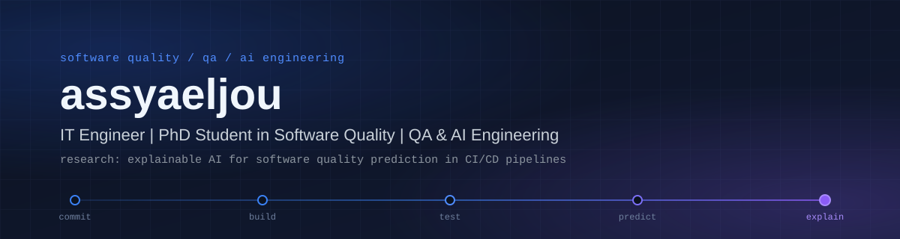

  

  
  
  
  
  

## About

I'm an IT engineer whose work keeps coming back to one question: how do we know software is good enough to ship? That interest started in QA and software testing (functional and regression testing, browser automation) and it's still what drives most of what I build.

Lately I've been putting AI agents to work on that problem. One project is a multi-agent system that triages bug reports; another is an agent that explores a web application, proposes tests from what it actually observed, and runs them only after a human approves. In both, I care more about traceable, evidence-backed output than about impressive demos.

I'm also a PhD student in software quality. My research looks at **Explainable AI for software quality prediction in CI/CD pipelines**: not only predicting where quality problems are likely to appear, but making those predictions understandable to the engineers who have to act on them.

## Technical Skills

Listed from what I use in the projects below.

<table>
  <tr>
    <td width="50%" valign="top">
      <b>Programming & Development</b> 
      Python · FastAPI · Streamlit 
      SQLite · SQLAlchemy
    </td>
    <td width="50%" valign="top">
      <b>QA & Testing</b> 
      Playwright · Pytest 
      Functional & regression testing
    </td>
  </tr>
  <tr>
    <td width="50%" valign="top">
      <b>AI & Agentic Systems</b> 
      LangGraph · LangChain · Pydantic 
      LLM integration (Ollama, OpenAI-compatible, Anthropic) 
      Structured outputs
    </td>
    <td width="50%" valign="top">
      <b>DevOps & CI/CD</b> 
      Git 
      JUnit XML & Allure reporting
    </td>
  </tr>
</table>

<!--
  Not shown yet: no evidence of these in the two featured repositories.
  Uncomment a line (and move it into the matching cell above) only if it's backed by real work.

  Programming & Development : JavaScript · SQL
  QA & Testing              : Selenium · API testing
  AI & Agentic Systems      : MCP
  DevOps & CI/CD            : Docker · GitHub Actions · CI/CD pipelines
-->

## Featured Projects

### [BugSense AI](https://github.com/assyaeljou/BugSense-AI)

Multi-agent bug report analysis and bulk triage. It runs on a local Ollama model, with a single-report workspace and a bulk workspace that share the same analysis pipeline.

- **Stack:** LangGraph · Ollama · Pydantic · Streamlit
- **Agents:** a LangGraph pipeline runs three specialists in sequence. The **Extractor** turns a free-text report into structured facts, the **Triage** agent assigns severity, priority and impact scope, and the **QA** agent audits the report for completeness and consistency and raises follow-up questions when it falls short.
- **Bulk triage:** import a batch from CSV or JSON, analyze each report independently (one failure never stops the batch), then rank and export the results as CSV, JSON or a PDF report.
- **Technical focus:** every field is labelled `CONFIRMED`, `INFERRED` or `MISSING`, so nothing the report didn't say is presented as fact. Each agent falls back to a deterministic rules engine if the model fails, and bulk ranking is deterministic (priority, then severity, then impact scope), never driven by model confidence.
- **Optional code context:** point it at a Git repository to localize likely files and get a proposed patch. Patches are checked with `git apply --check`, shown for human review, and never applied.

[View repository →](https://github.com/assyaeljou/BugSense-AI)

### [Autonomous AI Testing Agent](https://github.com/assyaeljou/Autonomous-AI-Testing-Agent)

An evidence-based, human-approved web application testing platform. You provide an authorized target URL; the system explores it, proposes test scenarios, waits for approval, executes them and reports the results.

- **Stack:** LangGraph · Playwright · Pytest · FastAPI · Streamlit · SQLite · Pydantic
- **Workflow:** four stages run as separate persisted jobs. The **Explorer** crawls the site with Playwright and records pages, locators, forms and interactions. The **Test Designer** asks an LLM for scenarios based on that evidence, and a deterministic validator checks them. After human approval, the **Executor** runs them through a pytest runtime. The **Failure Analyzer and Reporter** classify failures and produce JSON, HTML and Allure reports.
- **Technical focus:** the LLM proposes, deterministic code decides. Scenarios must be grounded in recorded evidence, nothing runs without human approval, LLM-generated Python is never executed, and report statistics are computed only from stored results. A risk factor with no supporting data is shown as unavailable rather than estimated.
- **LLM providers:** configurable between OpenAI-compatible endpoints, Anthropic, NVIDIA and local Ollama.
- **Status:** a working MVP. Its known limitations (single-process jobs, SQLite only, no authentication layer) are documented in the repository.

[View repository →](https://github.com/assyaeljou/Autonomous-AI-Testing-Agent)

## Research Interests

My PhD focuses on Explainable AI for software quality prediction in CI/CD pipelines. The areas around it:

- **Explainable AI for software quality prediction.** Understanding *why* a model flags a change or a build as risky.
- **Software quality in CI/CD pipelines.** Quality signals produced inside the delivery pipeline.
- **ML-based defect prediction.** Learning defect risk from engineering data.
- **Quality assurance and intelligent automation.** Where agents and ML can support testing work.

## Currently Exploring

- Agentic AI for software quality
- Intelligent QA workflows
- Explainability in software engineering
- CI/CD quality automation

<!--
  OPTIONAL: GitHub statistics
  Not enabled by default: these third-party widgets could not be checked while this README was
  generated, and the public instances are sometimes rate-limited. To enable, remove the comment
  markers, open the profile once, and make sure both images load before committing.

## GitHub Activity

  
  

-->

## Contact

- **GitHub:** [github.com/assyaeljou](https://github.com/assyaeljou)

<!--
  Add these only when you have the real URLs / address:

- **LinkedIn:** [your-name](https://www.linkedin.com/in/YOUR-PROFILE/)
- **Email:** [you@example.com](mailto:you@example.com)
-->
